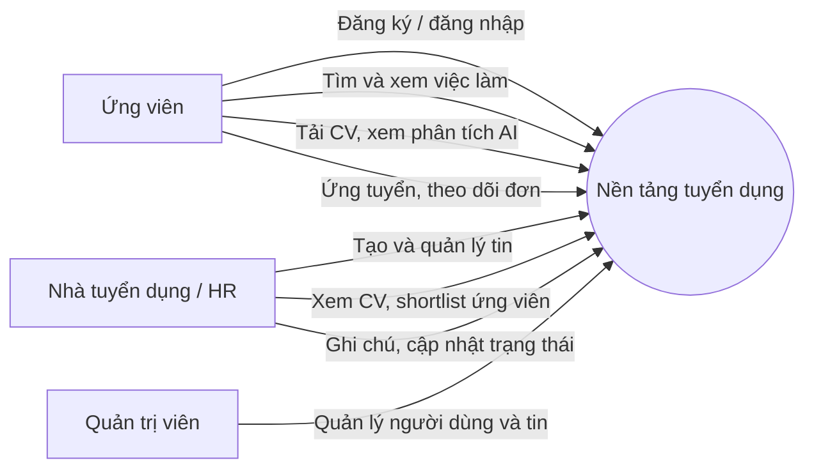
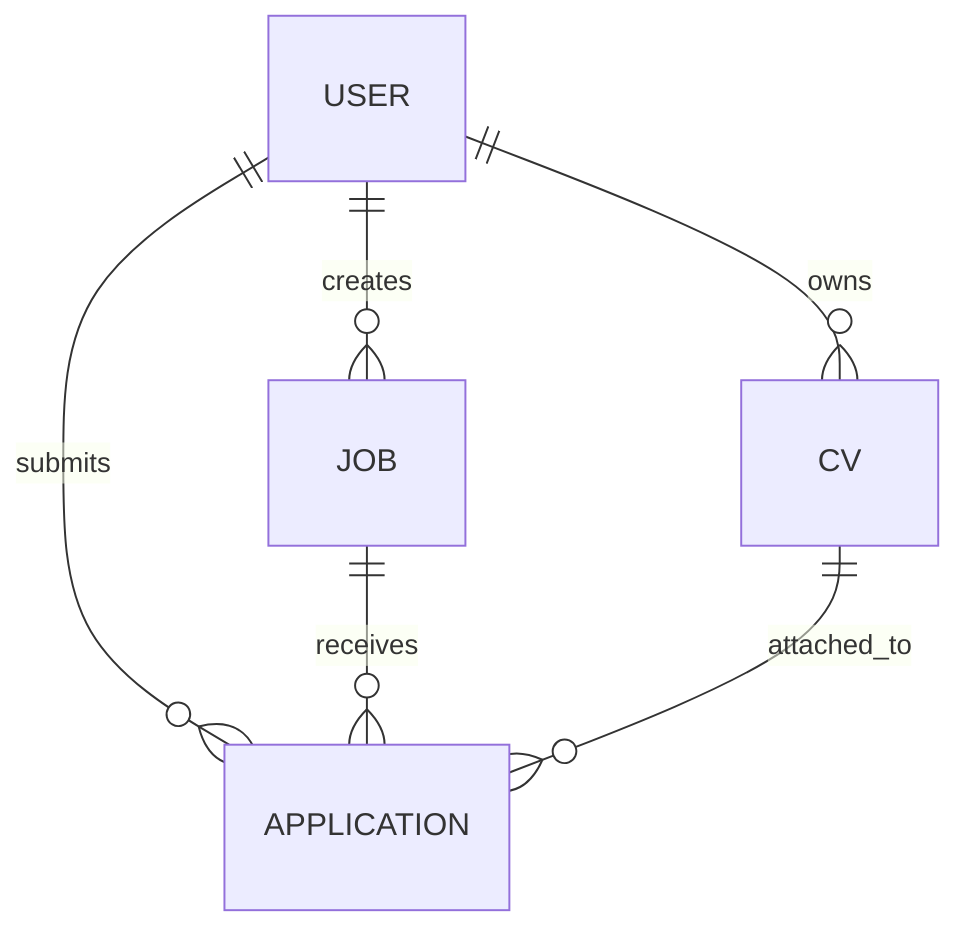

# BÁO CÁO ĐỒ ÁN TỐT NGHIỆP

## Nền tảng hỗ trợ tuyển dụng và phân tích hồ sơ ứng viên bằng AI

> **Bản thảo theo mã nguồn dự án DATN.** Thay các nội dung trong `[ngoặc vuông]` bằng thông tin chính thức; cập nhật ảnh chụp giao diện và kết quả kiểm thử thực tế trước khi nộp. Các mô tả kỹ thuật dưới đây được đối chiếu với mã nguồn hiện có.

---

## TRANG BÌA CHÍNH

**[TÊN TRƯỜNG ĐẠI HỌC]**  
**[TÊN KHOA / VIỆN]**

<br><br>

# ĐỒ ÁN TỐT NGHIỆP

## NỀN TẢNG HỖ TRỢ TUYỂN DỤNG VÀ PHÂN TÍCH HỒ SƠ ỨNG VIÊN BẰNG AI

**Giảng viên hướng dẫn:** [Họ và tên giảng viên]  
**Sinh viên thực hiện:** [Họ và tên sinh viên / các thành viên]  
**Mã sinh viên:** [Mã sinh viên]  
**Lớp:** [Lớp / khóa]

**[Địa phương], [năm]**

---

## TRANG BÌA PHỤ

**[TÊN TRƯỜNG ĐẠI HỌC] – [TÊN KHOA / VIỆN]**

### ĐỒ ÁN TỐT NGHIỆP

### NỀN TẢNG HỖ TRỢ TUYỂN DỤNG VÀ PHÂN TÍCH HỒ SƠ ỨNG VIÊN BẰNG AI

**Chuyên ngành:** [Tên chuyên ngành]  
**Giảng viên hướng dẫn:** [Họ tên, học hàm/học vị nếu có]  
**Sinh viên thực hiện:** [Họ tên – mã sinh viên]

**[Địa phương], [năm]**

---

## LỜI CAM ĐOAN

Chúng em xin cam đoan đồ án **“Nền tảng hỗ trợ tuyển dụng và phân tích hồ sơ ứng viên bằng AI”** là kết quả nghiên cứu và thực hiện của [cá nhân/nhóm]. Các nội dung tham khảo, thư viện, dịch vụ và tài liệu của tác giả khác được ghi nhận trong phần tài liệu tham khảo. Chúng em chịu trách nhiệm về tính trung thực của nội dung và kết quả trình bày trong báo cáo, đồng thời cam kết tuân thủ quy định về liêm chính học thuật của [tên trường].

**[Địa phương], ngày [..] tháng [..] năm [....]**  
**Đại diện sinh viên thực hiện**  
[Ký và ghi rõ họ tên]

## LỜI CẢM ƠN

Chúng em xin chân thành cảm ơn [họ tên giảng viên hướng dẫn] đã hướng dẫn, góp ý và hỗ trợ nhóm trong quá trình lựa chọn đề tài, phân tích yêu cầu và hoàn thiện sản phẩm. Những nhận xét của thầy/cô giúp nhóm điều chỉnh cách tiếp cận và củng cố kiến thức chuyên môn.

Chúng em cũng xin cảm ơn [tên khoa/trường], các thầy cô và những người đã hỗ trợ, chia sẻ ý kiến trong quá trình khảo sát và thực hiện đồ án. Do thời gian và kinh nghiệm còn hạn chế, báo cáo và sản phẩm có thể còn thiếu sót. Nhóm mong nhận được ý kiến đóng góp để tiếp tục hoàn thiện.

## TÓM TẮT

Đồ án xây dựng một nền tảng tuyển dụng trực tuyến kết nối ứng viên và nhà tuyển dụng, đồng thời hỗ trợ ứng viên hiểu rõ hơn nội dung hồ sơ của mình thông qua phân tích CV bằng mô hình ngôn ngữ Gemini. Ứng viên có thể tạo tài khoản, tìm kiếm tin tuyển dụng, tải CV PDF, xem nội dung được trích xuất, nhận nhận xét về điểm mạnh và đề xuất cải thiện, cũng như tham khảo các việc làm có kỹ năng gần với hồ sơ. Nhà tuyển dụng có thể quản lý tin tuyển dụng, xem hồ sơ ứng tuyển, ghi chú, cập nhật trạng thái và tham khảo danh sách ứng viên được xếp hạng theo mức độ phù hợp. Quản trị viên có thể theo dõi người dùng, tin tuyển dụng và điều chỉnh một số trạng thái hệ thống.

Hệ thống sử dụng React và SCSS ở phía giao diện; Node.js, Express và Mongoose ở phía máy chủ; MongoDB để lưu dữ liệu; Multer và hệ thống tệp để nhận, lưu CV; `pdf-parse` để trích xuất chữ từ PDF; Gemini API để phân tích nội dung CV theo cấu trúc JSON. Tệp được tính mã SHA-256 nhằm nhận diện CV trùng của cùng ứng viên. Kết quả thực tế cần được đánh giá bằng bộ kiểm thử và thử nghiệm người dùng trước khi đưa ra kết luận định lượng; báo cáo không giả định trước số liệu hiệu năng hay độ chính xác của AI.

**Từ khóa:** tuyển dụng trực tuyến, CV, phân tích hồ sơ, Gemini, MongoDB, Applicant Tracking System.

## ABSTRACT

This project develops an online recruitment platform that connects candidates and employers and uses the Gemini API to analyze résumé content. Candidates can register, browse job postings, upload PDF résumés, review extracted profile information, receive evidence-based strengths and improvement suggestions, and explore jobs whose requirements overlap with their skills. Employers can manage job postings, review applications, add notes, update application statuses, and consult a ranked shortlist based on candidate profile evidence. Administrators can inspect users and job postings and manage selected system states.

The frontend is built with React and SCSS. The backend uses Node.js, Express, and Mongoose, with MongoDB for structured data and the local filesystem for uploaded PDF files. Multer handles uploads, `pdf-parse` extracts text, and Gemini produces structured résumé analysis. SHA-256 hashes are used to detect duplicate files for the same candidate. Quantitative claims about usability, performance, or AI accuracy should be added only after running and documenting the corresponding evaluations.

**Keywords:** online recruitment, résumé analysis, Gemini, MongoDB, applicant tracking.

## MỤC LỤC

> Trong Word: áp dụng Heading 1/2/3 cho tiêu đề, sau đó chọn **References → Table of Contents** để tạo mục lục tự động. Cập nhật trường mục lục sau khi dàn trang.

- Lời cam đoan
- Lời cảm ơn
- Tóm tắt / Abstract
- Danh mục hình, bảng và chữ viết tắt
- Chương 1. Giới thiệu chung và tổng quan đề tài
- Chương 2. Cơ sở lý thuyết và công nghệ sử dụng
- Chương 3. Phân tích và thiết kế hệ thống
- Chương 4. Hiện thực hệ thống
- Chương 5. Kiểm thử và đánh giá hệ thống
- Chương 6. Kết luận và hướng phát triển
- Tài liệu tham khảo
- Phụ lục

## DANH MỤC HÌNH ẢNH

| Mã hình | Tên hình | Gợi ý bổ sung |
|---|---|---|
| Hình 3.1 | Sơ đồ ca sử dụng tổng quát | Vẽ từ các tác nhân và ca sử dụng tại Chương 3 |
| Hình 3.2 | Mô hình quan hệ các collection | Vẽ theo các tham chiếu trong MongoDB |
| Hình 3.3 | Luồng tải CV và nhận phân tích | Có thể dùng sơ đồ tuần tự |
| Hình 4.1 | Trang chủ | Chèn ảnh chụp ứng dụng chạy thực tế |
| Hình 4.2 | Danh sách và chi tiết việc làm | Chèn ảnh chụp ứng dụng chạy thực tế |
| Hình 4.3 | Trang tải CV và kết quả AI | Che thông tin cá nhân trong ảnh |
| Hình 4.4 | Khu vực quản lý tuyển dụng | Chèn ảnh HR Dashboard/Applications |
| Hình 4.5 | Khu vực quản trị | Chèn ảnh Admin Dashboard |

## DANH MỤC BẢNG BIỂU

| Mã bảng | Tên bảng |
|---|---|
| Bảng 2.1 | Công nghệ sử dụng trong dự án |
| Bảng 3.1 | Tác nhân và quyền chính |
| Bảng 3.2 | Các collection dữ liệu chính |
| Bảng 3.3 | Đặc tả một số API |
| Bảng 5.1 | Các trường hợp kiểm thử đề xuất |

## DANH MỤC CHỮ VIẾT TẮT

| Chữ viết tắt | Diễn giải |
|---|---|
| AI | Artificial Intelligence – Trí tuệ nhân tạo |
| API | Application Programming Interface |
| ATS | Applicant Tracking System |
| CV | Curriculum Vitae – Hồ sơ ứng viên |
| HR | Human Resources – Nhân sự / nhà tuyển dụng |
| HTTP | Hypertext Transfer Protocol |
| JSON | JavaScript Object Notation |
| LLM | Large Language Model – Mô hình ngôn ngữ lớn |
| REST | Representational State Transfer |
| UI/UX | User Interface / User Experience |

# CHƯƠNG 1. GIỚI THIỆU CHUNG VÀ TỔNG QUAN ĐỀ TÀI

## 1.1. Đặt vấn đề và tính cấp thiết

Quá trình tuyển dụng thường bắt đầu bằng việc doanh nghiệp đăng tin, tiếp nhận nhiều hồ sơ, đọc CV, đối chiếu yêu cầu công việc và liên hệ ứng viên phù hợp. Khi số lượng hồ sơ tăng, việc theo dõi trạng thái và sàng lọc thủ công có thể tốn thời gian, khó duy trì tiêu chí nhất quán và làm cho ứng viên thiếu thông tin về tiến trình ứng tuyển. Ở chiều ngược lại, ứng viên có thể gặp khó khăn khi xác định CV đã trình bày rõ kỹ năng, kinh nghiệm và thành tựu phù hợp với vị trí hay chưa.

Đề tài được lựa chọn nhằm xây dựng một điểm truy cập thống nhất cho tin tuyển dụng và hồ sơ ứng viên, đồng thời thử nghiệm việc dùng AI để tổ chức nội dung CV thành các trường dữ liệu có cấu trúc. AI được sử dụng như công cụ hỗ trợ đọc và góp ý; quyết định tuyển dụng cuối cùng vẫn thuộc về nhà tuyển dụng. Việc trình bày rõ bằng chứng trong CV và giới hạn của phân tích tự động là cần thiết để tránh xem điểm phù hợp như một kết luận chắc chắn về năng lực.

## 1.2. Mục tiêu đề tài

Mục tiêu tổng quát là phân tích, thiết kế và hiện thực một ứng dụng web tuyển dụng có các vai trò ứng viên, HR và quản trị viên.

Các mục tiêu cụ thể:

1. Cho phép người dùng đăng ký, đăng nhập và truy cập chức năng theo vai trò.
2. Cho phép xem tin việc làm; HR tạo, cập nhật và quản lý tin tuyển dụng.
3. Cho phép ứng viên tải CV định dạng PDF và xem kết quả phân tích có cấu trúc.
4. Giảm việc lưu nhiều bản sao cùng một CV của một ứng viên bằng mã băm SHA-256.
5. Hỗ trợ ứng viên tham khảo việc làm dựa trên kỹ năng trích xuất và hỗ trợ HR sắp xếp ứng viên theo mức độ khớp với tin tuyển dụng.
6. Hỗ trợ quy trình ứng tuyển, theo dõi trạng thái, ghi chú đánh giá và quản trị dữ liệu cơ bản.

## 1.3. Đối tượng và phạm vi nghiên cứu

**Đối tượng sử dụng:** ứng viên (`CANDIDATE`), nhà tuyển dụng (`HR`) và quản trị viên (`ADMIN`).

**Phạm vi chức năng hiện có:** xác thực bằng JWT; phân quyền theo vai trò; xem danh sách/chi tiết việc làm; HR quản lý việc làm; ứng viên tải CV PDF, xem phân tích AI và việc làm gợi ý; ứng tuyển bằng CV; HR xem hồ sơ, shortlist, ghi chú và cập nhật trạng thái; quản trị viên xem tổng quan, danh sách người dùng/việc làm và cập nhật vai trò/trạng thái.

**Giới hạn:** ứng dụng nhận CV PDF tối đa 10 MB; tệp được lưu trên hệ thống tệp cục bộ của máy chủ, còn metadata và nội dung phân tích được lưu trong MongoDB. Việc phân tích cần kết nối Gemini API và cấu hình khóa API. Dự án hiện dùng JavaScript và SCSS; không thấy TypeScript, Tailwind CSS hay một dịch vụ Python/FastAPI trong mã nguồn. Bản triển khai cần tự cấu hình tên miền, lưu trữ tệp bền vững, sao lưu, giám sát và chính sách bảo vệ dữ liệu phù hợp.

## 1.4. Phương pháp nghiên cứu và phát triển

Nhóm khảo sát quy trình tuyển dụng cơ bản, xác định vai trò và các thao tác chính, sau đó đối chiếu yêu cầu với cấu trúc giao diện, API và mô hình dữ liệu. Quy trình phát triển được tổ chức theo các bước lặp: xác định yêu cầu, thiết kế, cài đặt, kiểm tra và điều chỉnh. Đây là mô tả quy trình phù hợp với cách triển khai phần mềm theo vòng lặp; nếu nhóm thực sự áp dụng Scrum, cần bổ sung thời gian sprint, backlog, vai trò và biên bản tương ứng.

Phương pháp kỹ thuật gồm phân tích yêu cầu chức năng; thiết kế mô hình dữ liệu hướng tài liệu; xây dựng API REST; xác thực và phân quyền ở máy chủ; xử lý PDF; tích hợp dịch vụ AI; kiểm thử chức năng bằng các ca kiểm thử. Báo cáo cần ghi nhận môi trường và kết quả chạy thực tế ở mục 5.2.

# CHƯƠNG 2. CƠ SỞ LÝ THUYẾT VÀ CÔNG NGHỆ SỬ DỤNG

## 2.1. Các khái niệm nền tảng

### 2.1.1. Cổng tuyển dụng trực tuyến

Job Portal là hệ thống trực tuyến cho phép nhà tuyển dụng công bố cơ hội việc làm và ứng viên tìm kiếm, xem chi tiết, nộp hồ sơ. Trong đồ án, tin tuyển dụng chứa chức danh, mô tả, công ty, địa điểm, khoảng lương, kỹ năng, hình thức làm việc và trạng thái mở/đóng.

### 2.1.2. Hệ thống theo dõi ứng viên

Applicant Tracking System (ATS) hỗ trợ quản lý hồ sơ trong các bước của quy trình tuyển dụng. Ứng dụng này có các chức năng mang tính ATS như lưu đơn ứng tuyển, liên kết đơn với CV và việc làm, lọc theo trạng thái, ghi chú của HR và shortlist hỗ trợ. Đây là một hệ thống quy mô đồ án, chưa nhằm thay thế các ATS doanh nghiệp đầy đủ.

### 2.1.3. AI trong phân tích CV

Mô hình ngôn ngữ nhận nội dung CV và trả về các trường như thông tin cá nhân, tóm tắt, kỹ năng, học vấn, kinh nghiệm, điểm mạnh, đề xuất cải thiện và thông tin còn thiếu. Kết quả được yêu cầu theo JSON schema để máy chủ có thể lưu và giao diện hiển thị thống nhất. Mô hình có thể sai hoặc bỏ sót nội dung; do đó kết quả là gợi ý cần được người dùng kiểm tra. Hệ thống có chỉ dẫn yêu cầu AI không làm theo chỉ thị nhúng trong CV và chỉ kết luận dựa trên bằng chứng, nhưng điều đó không bảo đảm loại bỏ hoàn toàn sai lệch.

## 2.2. Công nghệ và công cụ phát triển

| Thành phần | Công nghệ trong mã nguồn | Vai trò |
|---|---|---|
| Frontend | React, React Router, JavaScript, SCSS, Vite | Xây dựng trang, điều hướng, giao diện và biểu mẫu |
| Gọi API | Axios và Fetch API | Gửi yêu cầu đến backend; gắn JWT ở các yêu cầu Axios |
| Backend | Node.js, Express 5 | Xây dựng REST API và xử lý nghiệp vụ |
| Cơ sở dữ liệu | MongoDB, Mongoose | Lưu người dùng, việc làm, CV và đơn ứng tuyển |
| Tải tệp | Multer | Nhận tệp PDF, giới hạn 10 MB, lưu tạm trước khi xử lý |
| PDF | `pdf-parse` | Trích xuất văn bản từ PDF có lớp chữ |
| AI | Google GenAI SDK, Gemini API | Phân tích CV thành JSON; tạo mô tả công việc theo logic hiện tại |
| Bảo mật hỗ trợ | `jsonwebtoken`, `bcryptjs`, `helmet`, CORS | Token xác thực, băm mật khẩu, header bảo mật và cấu hình chia sẻ nguồn |
| Lưu trạng thái trình duyệt | `localStorage`, `sessionStorage` | Lưu token/người dùng; giữ kết quả tải CV trong phiên trình duyệt |

Dự án không sử dụng TypeScript, Tailwind CSS hoặc FastAPI theo cấu hình và mã nguồn được khảo sát. Backend hiện là một ứng dụng Node.js duy nhất; Python/FastAPI không tham gia luồng xử lý. Phân tích CV được gọi qua Gemini API bằng SDK `@google/genai`.

### 2.2.1. Công nghệ phía giao diện

React tổ chức giao diện thành các trang và component. React Router khai báo các tuyến như trang chủ, danh sách việc làm, chi tiết việc làm, tải CV, hồ sơ cá nhân, khu vực HR và khu vực quản trị. SCSS được dùng để định dạng giao diện. `ProtectedRoute` kiểm tra token và vai trò đã lưu ở trình duyệt để điều hướng người dùng; backend vẫn phải xác thực và phân quyền độc lập cho API.

### 2.2.2. Công nghệ phía máy chủ

Express khai báo các tuyến API và middleware. Mongoose định nghĩa schema, kiểm tra một số giá trị enum và quan hệ tham chiếu giữa collection. Middleware JWT xác thực người dùng, middleware vai trò giới hạn thao tác. Mật khẩu được xử lý qua `bcryptjs`; JWT cung cấp token truy cập. Các biến cấu hình nhạy cảm như URI MongoDB và khóa Gemini cần đặt trong môi trường máy chủ, không ghi vào mã nguồn.

### 2.2.3. Cơ sở dữ liệu và tệp

MongoDB lưu dữ liệu nghiệp vụ. Tệp PDF lưu trong thư mục `uploads/cv` sau khi được nhận ở thư mục tạm. `fileHash` sử dụng SHA-256 để tìm bản trùng thuộc cùng ứng viên. Tệp không được lưu trực tiếp trong document MongoDB. Trong môi trường triển khai nhiều máy chủ hoặc không có ổ đĩa bền vững, cần thay bằng dịch vụ lưu trữ đối tượng và cơ chế dọn dẹp/sao lưu tương ứng.

### 2.2.4. Tích hợp AI

Máy chủ gửi văn bản PDF đã trích xuất hoặc gửi PDF trực tiếp nếu không trích được đủ văn bản. Gemini được yêu cầu trả JSON theo schema, bao gồm `personalInfo`, `summary`, `strengths`, `improvementSuggestions`, `skills`, `education`, `experienceYears`, `workExperience`, `languages`, `certifications` và `missingInformation`. Kết quả và trạng thái được lưu ở CV. Logic so khớp công việc hiện chuẩn hóa chữ thường và dấu, đối chiếu kỹ năng, từ khóa chức danh, và số năm kinh nghiệm nếu mô tả công việc có thể nhận diện số năm.

# CHƯƠNG 3. PHÂN TÍCH VÀ THIẾT KẾ HỆ THỐNG

## 3.1. Khảo sát yêu cầu và tác nhân

| Tác nhân | Nhu cầu và quyền chính |
|---|---|
| Ứng viên | Đăng ký/đăng nhập; tìm việc; tải và phân tích CV; xem việc làm gợi ý; ứng tuyển; theo dõi đơn; tạo CV từ giao diện hỗ trợ |
| Nhà tuyển dụng (HR) | Quản lý tin do mình tạo; xem hồ sơ ứng tuyển; xem CV; tham khảo shortlist; ghi chú và cập nhật trạng thái ứng viên |
| Quản trị viên | Xem tổng quan, người dùng và việc làm; thay đổi vai trò người dùng; đổi trạng thái hoặc xóa tin tuyển dụng |

Yêu cầu phi chức năng gồm giao diện dễ hiểu, kiểm tra dữ liệu đầu vào, phân quyền phía máy chủ, thông báo lỗi phù hợp và lưu trữ dữ liệu nhất quán. Các yêu cầu về tải đồng thời, thời gian phản hồi, khả năng truy cập và tiêu chuẩn bảo mật cần được đo/đặc tả thêm nếu dùng trong môi trường thực tế.

## 3.2. Sơ đồ ca sử dụng

Sơ đồ khái quát dưới đây có thể chuyển thành hình UML trong bản Word:



## 3.3. Thiết kế cơ sở dữ liệu

Hệ thống dùng bốn collection nghiệp vụ chính. Các trường `_id`, `createdAt`, `updatedAt` do MongoDB/Mongoose quản lý theo cấu hình schema.

### 3.3.1. Collection `User`

| Trường | Kiểu / ràng buộc | Ý nghĩa |
|---|---|---|
| `name` | String, bắt buộc | Tên hiển thị |
| `email` | String, bắt buộc, duy nhất, chữ thường | Định danh đăng nhập |
| `password` | String, bắt buộc, tối thiểu 6 ký tự | Mật khẩu đã băm trước khi lưu theo luồng xác thực |
| `role` | `ADMIN`, `HR`, `CANDIDATE` | Vai trò tài khoản |

### 3.3.2. Collection `Job`

Các trường chính gồm `title`, `description`, `company`, `location`, `salaryMin`, `salaryMax`, `skills`, `employmentType` (`FULL_TIME`, `PART_TIME`, `INTERNSHIP`), `status` (`OPEN`, `CLOSED`) và `createdBy` tham chiếu `User` tạo tin.

### 3.3.3. Collection `CV`

| Trường | Ý nghĩa |
|---|---|
| `candidate` | Tham chiếu ứng viên sở hữu CV |
| `originalName`, `fileName`, `filePath` | Tên gốc, tên lưu và đường dẫn tệp |
| `fileHash` | SHA-256 phục vụ nhận diện tệp trùng theo ứng viên |
| `extractedText` | Văn bản lấy từ PDF hoặc văn bản gốc được AI đọc |
| `aiStatus` | `PENDING`, `COMPLETED` hoặc `FAILED` |
| `aiAnalysis` | Thông tin cá nhân, tóm tắt, điểm mạnh, đề xuất, kỹ năng, học vấn, kinh nghiệm, ngoại ngữ, chứng chỉ và thông tin thiếu |
| `uploadedAt` | Thời điểm tải lên |

Schema có index ghép `{ candidate: 1, fileHash: 1 }`. Logic tìm trùng chỉ xét cùng ứng viên. Khi gặp CV cũ thiếu hash, dịch vụ có thể tính lại hash từ tệp hiện hữu.

### 3.3.4. Collection `Application`

`Application` liên kết `candidate`, `job` và `cv`; lưu `coverLetter`, `status` (`PENDING`, `SHORTLISTED`, `INTERVIEW`, `REJECTED`, `ACCEPTED`) và `hrNote` tối đa 2.000 ký tự. HR chỉ được đọc/quản lý đơn thuộc tin do chính HR tạo theo kiểm tra trong service.



## 3.4. Thiết kế giao diện và luồng người dùng

**Luồng ứng viên:** Trang chủ → danh sách việc làm → chi tiết → đăng nhập/đăng ký → tải CV hoặc ứng tuyển → xem trạng thái đơn. Tại trang CV, ứng viên chọn PDF, nhận kết quả phân tích, xem kỹ năng và đề xuất, sau đó tham khảo các việc làm được xếp hạng.

**Luồng HR:** đăng nhập → dashboard/quản lý tin → tạo hoặc chỉnh sửa tin → xem đơn ứng tuyển → đọc CV/shortlist → thêm ghi chú và cập nhật trạng thái.

**Luồng quản trị:** đăng nhập → dashboard quản trị → xem người dùng/việc làm → điều chỉnh vai trò hoặc trạng thái tin.

Giao diện chính được tổ chức trong các trang `Home`, `JobList`, `JobDetail`, `CVUpload`, `MyApplications`, `HRDashboard`, `HRJobs`, `HRApplications` và `AdminDashboard`. Chèn ảnh chụp thực tế vào các vị trí Hình 4.1–4.5. Cần ẩn tên, email, số điện thoại và dữ liệu cá nhân của người thử nghiệm trước khi đưa ảnh vào báo cáo.

# CHƯƠNG 4. HIỆN THỰC HỆ THỐNG

## 4.1. Xây dựng phía Backend

### 4.1.1. Khởi tạo và kết nối

Máy chủ nạp cấu hình môi trường, kết nối MongoDB bằng Mongoose, sau đó khởi chạy Express trên cổng cấu hình hoặc cổng 3000 mặc định. Ứng dụng đăng ký CORS, Helmet, Morgan và JSON parser. Các nhóm tuyến được đặt dưới `/api/auth`, `/api/jobs`, `/api/applications`, `/api/cv` và `/api/admin`.

### 4.1.2. Xác thực và phân quyền

Người dùng đăng nhập nhận JWT; các API cần bảo vệ dùng middleware `protect`, sau đó `authorize` kiểm tra vai trò. Ví dụ, tải CV yêu cầu vai trò `CANDIDATE`; tạo và quản lý tin yêu cầu `HR`; các tuyến quản trị yêu cầu `ADMIN`. Giao diện ẩn/hiện tuyến theo vai trò giúp điều hướng, còn quyền truy cập dữ liệu được kiểm tra lại tại backend.

### 4.1.3. Luồng tải và phân tích CV

1. Multer nhận trường `cv`, chỉ chấp nhận MIME PDF, giới hạn 10 MB và đặt tệp ở vùng tạm.
2. Dịch vụ tính SHA-256 và tìm CV cùng hash của cùng ứng viên. Nếu trùng, tệp tạm được xóa và bản ghi hiện có được dùng lại.
3. Nếu là tệp mới, hệ thống thử trích xuất chữ bằng `pdf-parse`, chuyển tệp sang `uploads/cv`, tạo bản ghi CV ở trạng thái `PENDING`.
4. Backend gọi Gemini với văn bản đã trích xuất; nếu không có văn bản đủ dùng, gửi nội dung PDF để mô hình đọc trực tiếp.
5. Khi thành công, lưu `aiAnalysis` và đặt `aiStatus` thành `COMPLETED`; nếu lỗi, đặt `FAILED` và giữ bản CV đã lưu để có thể thử phân tích lại trong một số luồng.

Trong request upload hiện tại, xử lý phân tích diễn ra đồng bộ trong luồng yêu cầu. `PENDING` là trạng thái khởi tạo/lưu trước khi gọi AI, không phải bằng chứng có hàng đợi nền. Báo cáo cần phân biệt điểm này khi mô tả trải nghiệm và hiệu năng.

### 4.1.4. API tiêu biểu

| Phương thức | Đường dẫn | Mục đích / quyền |
|---|---|---|
| `GET` | `/api/jobs` | Danh sách tin công khai |
| `GET` | `/api/jobs/:id` | Chi tiết tin |
| `POST` | `/api/jobs` | HR tạo tin |
| `POST` | `/api/cv/upload` | Ứng viên tải và phân tích CV |
| `POST` | `/api/applications` | Ứng viên nộp hồ sơ, kèm CV PDF |
| `GET` | `/api/applications/my` | Ứng viên xem đơn của mình |
| `GET` | `/api/applications/hr` | HR xem các đơn thuộc tin của HR |
| `GET` | `/api/applications/hr/shortlist/:jobId` | HR xem shortlist theo tin |
| `PATCH` | `/api/applications/:id/status` | HR đổi trạng thái đơn |
| `GET` | `/api/admin/overview` | Admin xem tổng quan |

## 4.2. Xây dựng phía Frontend

Ứng dụng React định nghĩa route theo vai trò. Axios có interceptor gắn JWT trong header `Authorization: Bearer ...`; khi API trả 401 (ngoại trừ đăng nhập/đăng ký), client xóa token và thông tin người dùng trong `localStorage`, sau đó đưa người dùng về trang đăng nhập.

Component `CVUpload` kiểm tra kích thước tệp ở giao diện, gửi PDF đến `/api/cv/upload`, hiển thị trạng thái tải và kết quả. Kết quả cùng các việc làm gợi ý được lưu bằng `sessionStorage` dưới khóa `cv-upload-result`; dữ liệu tồn tại trong phiên tab và được khôi phục khi tải lại trang. `localStorage` được dùng cho token và đối tượng người dùng. Hai cơ chế này giữ dữ liệu phía trình duyệt; chúng không thay thế lưu trữ bền vững tại máy chủ.

Giao diện cho phép xem điểm mạnh và các đề xuất có căn cứ, chỉnh sửa nội dung dự thảo trước khi chuyển sang trang tạo CV. Việc lưu bản CV đã chỉnh sửa hoặc xuất bản mới cần được kiểm tra theo luồng cụ thể khi nghiệm thu.

## 4.3. Minh họa màn hình

> Thay các dòng dưới đây bằng ảnh chụp của ứng dụng chạy thực tế. Dùng caption và số thứ tự đồng nhất với danh mục hình.

**Hình 4.1. Trang chủ**  
`[Chèn ảnh chụp client/src/pages/Home.jsx]`

**Hình 4.2. Danh sách việc làm và chi tiết công việc**  
`[Chèn ảnh chụp client/src/pages/JobList.jsx và JobDetail.jsx]`

**Hình 4.3. Tải CV và kết quả phân tích AI**  
`[Chèn ảnh chụp client/src/components/CVUpload.jsx; che dữ liệu cá nhân]`

**Hình 4.4. Quản lý đơn ứng tuyển phía HR**  
`[Chèn ảnh chụp client/src/pages/HRApplications.jsx]`

**Hình 4.5. Bảng điều khiển quản trị**  
`[Chèn ảnh chụp client/src/pages/AdminDashboard.jsx]`

# CHƯƠNG 5. KIỂM THỬ VÀ ĐÁNH GIÁ HỆ THỐNG

## 5.1. Phương pháp kiểm thử

Kiểm thử chức năng theo luồng người dùng và API: xác thực, quyền theo vai trò, quản lý tin, tải tệp, phát hiện CV trùng, xử lý phản hồi AI, ứng tuyển và cập nhật trạng thái. Kiểm thử giao diện cần thực hiện trên các kích thước màn hình và kiểm tra thông báo lỗi, trạng thái tải, dữ liệu rỗng. Các bài kiểm thử tự động có trong `server/tests`; cần chạy chúng trong môi trường được cấu hình phù hợp và ghi lại lệnh, ngày, phiên bản và kết quả thực tế. Báo cáo này không khẳng định các bài kiểm thử đã chạy.

## 5.2. Các trường hợp kiểm thử

| ID | Tình huống | Kết quả mong đợi | Kết quả thực tế |
|---|---|---|---|
| TC-01 | Ứng viên tải PDF hợp lệ không quá 10 MB | Máy chủ lưu CV và trả kết quả phân tích hoặc trạng thái lỗi AI rõ ràng | `[Điền sau khi chạy]` |
| TC-02 | Tải tệp không phải PDF | API từ chối với mã 400 và thông báo định dạng | `[Điền sau khi chạy]` |
| TC-03 | Tải PDF vượt 10 MB | API từ chối tệp vượt giới hạn | `[Điền sau khi chạy]` |
| TC-04 | Cùng ứng viên tải lại đúng cùng tệp | Tái sử dụng bản ghi CV và không giữ thêm bản tệp trùng | `[Điền sau khi chạy]` |
| TC-05 | Hai ứng viên tải cùng nội dung CV | Mỗi ứng viên có bản ghi riêng vì khóa trùng gồm cả candidate | `[Điền sau khi chạy]` |
| TC-06 | Gemini trả kết quả hợp lệ | `aiStatus=COMPLETED`, `aiAnalysis` có cấu trúc theo schema | `[Điền sau khi chạy]` |
| TC-07 | Gemini lỗi hoặc không khả dụng | `aiStatus=FAILED`; lỗi không làm mất CV đã lưu | `[Điền sau khi chạy]` |
| TC-08 | Người không có quyền gọi API HR/Admin | Backend từ chối truy cập | `[Điền sau khi chạy]` |
| TC-09 | Ứng viên ứng tuyển hai lần cùng một tin | Lần tiếp theo bị từ chối theo quy tắc nghiệp vụ | `[Điền sau khi chạy]` |
| TC-10 | HR đổi trạng thái đơn hợp lệ | Trạng thái được lưu và trả về dữ liệu cập nhật | `[Điền sau khi chạy]` |
| TC-11 | Làm mới trang kết quả CV trong cùng phiên tab | Khôi phục kết quả từ `sessionStorage` | `[Điền sau khi chạy]` |
| TC-12 | Tìm kiếm/lọc việc làm trên giao diện | Danh sách hiển thị phù hợp với thao tác đã nhập | `[Điền sau khi chạy]` |

Trong mã nguồn có các bài kiểm thử phía server liên quan đến xóa tin, khử trùng lặp CV, middleware xác thực, suy giảm khi AI lỗi, shortlist và matching. Cần chạy `npm test` trong thư mục `server` để xác nhận trạng thái hiện tại; nếu kiểm thử cần MongoDB hoặc dịch vụ ngoài, ghi lại cấu hình và giới hạn tương ứng.

## 5.3. Đánh giá ưu điểm và hạn chế

**Ưu điểm:** hệ thống gom các thao tác tìm việc, nộp hồ sơ và theo dõi tuyển dụng; phân quyền theo vai trò; phân tích CV trả về dữ liệu có cấu trúc; đề xuất cải thiện có trường bằng chứng; nhận diện CV trùng trong phạm vi một ứng viên; HR có công cụ shortlist, ghi chú và cập nhật trạng thái.

**Hạn chế:** chất lượng phân tích phụ thuộc chất lượng PDF, ngôn ngữ và dịch vụ Gemini; kết quả AI có thể thiếu hoặc sai và chưa có đánh giá định lượng độ chính xác. Việc gọi AI đồng bộ có thể kéo dài thời gian phản hồi. Hash chỉ nhận diện tệp nhị phân giống hệt, không nhận diện các CV cùng nội dung nhưng khác cách lưu/định dạng. File system cục bộ gây hạn chế khi mở rộng nhiều máy chủ. Matching hiện là luật dựa trên kỹ năng, từ khóa vai trò và kinh nghiệm, không phải mô hình xếp hạng đã được huấn luyện. `sessionStorage` mất dữ liệu khi phiên tab kết thúc. Cần bổ sung kiểm thử bảo mật, kiểm soát quyền riêng tư, giám sát, sao lưu và đánh giá khả năng sử dụng trước triển khai rộng.

# CHƯƠNG 6. KẾT LUẬN VÀ HƯỚNG PHÁT TRIỂN

## 6.1. Tổng kết kết quả

Đồ án đã thiết kế và hiện thực nền tảng tuyển dụng web với ba vai trò chính. Hệ thống hỗ trợ quản lý tin việc làm, nộp và theo dõi hồ sơ, tải CV PDF, nhận phân tích có cấu trúc từ Gemini, nhận diện CV trùng theo mã SHA-256, gợi ý việc làm dựa trên kỹ năng và hỗ trợ HR sắp xếp ứng viên. Các mục tiêu chức năng chính được phản ánh trong mã nguồn client và server. Mức độ hoàn thành chất lượng, hiệu năng và độ chính xác cần được kết luận dựa trên kết quả kiểm thử thực tế được bổ sung vào báo cáo.

## 6.2. Hướng phát triển

1. Xây dựng pipeline xử lý CV nền có hàng đợi, retry có kiểm soát và thông báo tiến độ.
2. Cải thiện matching bằng biểu diễn ngữ nghĩa, trọng số có thể giải thích và đánh giá trên tập dữ liệu có gán nhãn; tránh dùng điểm số như quyết định tuyển dụng tự động.
3. Bổ sung tính năng phỏng vấn thử AI với nội dung phù hợp từng vị trí và quy tắc bảo vệ dữ liệu.
4. Chuyển file sang object storage, ký URL truy cập có thời hạn, thiết lập thời gian lưu và quy trình xóa dữ liệu.
5. Tăng cường bảo mật: quản lý secret, giới hạn tốc độ, kiểm tra MIME/nội dung thực của PDF, chống tải tệp độc hại, audit log và kiểm thử phân quyền.
6. Bổ sung thông báo email, lịch phỏng vấn, tìm kiếm nâng cao, thống kê và giao diện tương thích di động.
7. Đo hiệu năng, khả năng sử dụng và chất lượng phân tích AI trên bộ dữ liệu phù hợp, có đồng thuận và ẩn danh.

# TÀI LIỆU THAM KHẢO

> Chuẩn hóa theo mẫu APA/IEEE mà khoa yêu cầu. Ngày truy cập và phiên bản cần cập nhật theo thời điểm nhóm hoàn thiện báo cáo.

[1] React, “React Documentation.” https://react.dev/ (truy cập ngày [..]).  
[2] Express, “Express – Node.js web application framework.” https://expressjs.com/ (truy cập ngày [..]).  
[3] MongoDB, “MongoDB Manual.” https://www.mongodb.com/docs/manual/ (truy cập ngày [..]).  
[4] Mongoose, “Mongoose Guide.” https://mongoosejs.com/docs/guide.html (truy cập ngày [..]).  
[5] Google, “Gemini API Documentation.” https://ai.google.dev/gemini-api/docs (truy cập ngày [..]).  
[6] Google for Developers, “Google Gen AI SDK.” https://googleapis.github.io/js-genai/ (truy cập ngày [..]).  
[7] MDN Web Docs, “Window: sessionStorage property.” https://developer.mozilla.org/docs/Web/API/Window/sessionStorage (truy cập ngày [..]).  
[8] Dự án DATN, mã nguồn và bộ kiểm thử nội bộ, [đường dẫn repository hoặc thông tin lưu trữ], phiên bản [commit/tag], [năm].

# PHỤ LỤC A. CẤU TRÚC MÃ NGUỒN

- `client/src/pages`, `client/src/components`: trang và component React.
- `client/src/scss`: kiểu dáng giao diện.
- `client/src/services/api.js`: cấu hình Axios và JWT interceptor.
- `server/src/routes`: định nghĩa tuyến API.
- `server/src/controllers`: xử lý request/response.
- `server/src/services`: nghiệp vụ ứng dụng, AI, PDF và tệp CV.
- `server/src/models`: schema Mongoose cho User, Job, CV và Application.
- `server/src/middlewares`: xác thực, phân quyền và upload.
- `server/tests`: các bài kiểm thử tự động phía server.

# PHỤ LỤC B. MẪU DỮ LIỆU PHÂN TÍCH CV

```json
{
  "personalInfo": {
    "fullName": "[trích xuất từ CV]",
    "email": "",
    "phone": "",
    "location": ""
  },
  "summary": "[tóm tắt có căn cứ]",
  "strengths": [],
  "improvementSuggestions": [
    {
      "issue": "[vấn đề]",
      "evidence": "[căn cứ trong CV]",
      "recommendation": "[hướng cải thiện]",
      "example": "[ví dụ, không thêm dữ kiện chưa có]"
    }
  ],
  "skills": [],
  "education": [],
  "experienceYears": 0,
  "workExperience": [],
  "languages": [],
  "certifications": [],
  "missingInformation": []
}
```

# PHỤ LỤC C. THÔNG TIN CẦN HOÀN THIỆN TRƯỚC KHI NỘP

1. Điền tên trường, khoa, chuyên ngành, giảng viên, sinh viên, mã sinh viên, lớp, địa phương và năm.
2. Xác nhận chính xác quy trình nghiên cứu/phát triển mà nhóm đã thực hiện; không ghi Scrum nếu không có sprint/backlog thực tế.
3. Chạy bộ kiểm thử, điền kết quả thực tế và mô tả môi trường kiểm thử.
4. Chụp ảnh các màn hình, che dữ liệu cá nhân và cập nhật danh mục hình.
5. Thêm sơ đồ UML/ERD được xuất thành hình nếu mẫu báo cáo của trường yêu cầu.
6. Kiểm tra chính sách trích dẫn, định dạng trang, cỡ chữ và cách đánh số của khoa; tạo mục lục tự động sau cùng.
